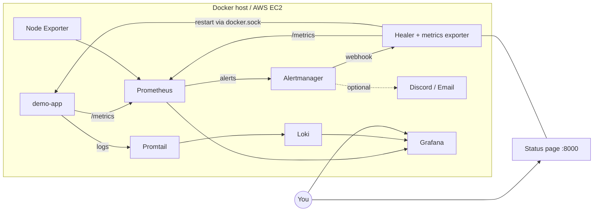

# 🛡️ ContainerWatch Pro
### A self-healing Docker monitoring platform with chaos testing, log search and AWS deployment

> Containers crash. This project **detects it, fixes it automatically, tells you about it, and proves it with data.**

## ✨ Features
| Feature | What it does |
|---|---|
| 🔧 **Self-healing engine** | Python service restarts exited or unhealthy containers (cooldown + restart-loop alert) |
| 📈 **Custom metrics exporter** | Reads CPU and memory per container from the Docker API and exposes them to Prometheus |
| 💥 **Chaos engineering** | Crash, fail health checks, burn CPU, fill memory, then watch the platform recover |
| 📊 **Dashboards** | Auto-provisioned Grafana dashboard (metrics + live logs from Loki) |
| 🚨 **Alerting** | CPU > 80%, memory > 85%, target down, self-healed, restart loop. Discord/email ready |
| 🖥️ **Live status page** | Container health cards + event timeline in your local time (port 8000) |
| ☁️ **Terraform on AWS** | EC2, Elastic IP, IAM/SSM, IP-restricted firewall, IMDSv2, encrypted disk, budget alert |
| 🔁 **CI/CD** | GitHub Actions: tests, promtool/amtool/terraform validation, Trivy scan, deploy |

## 🏗️ Architecture


## 🚀 Quick start
```
copy .env.example .env        (Mac/Linux: cp .env.example .env)
docker compose up -d --build
.\scripts\verify.ps1          (Mac/Linux: ./scripts/verify.sh)
```
| Service | URL |
|---|---|
| Status page | http://localhost:8000 |
| Grafana (admin / your password) | http://localhost:3001 |
| Prometheus | http://localhost:9090 |
| Alertmanager | http://localhost:9093 |
| Demo app | http://localhost:5001 |

Break it on purpose: `.\scripts\chaos.ps1 unhealthy` and watch the status page.

📘 **Full beginner guide: [GUIDE.md](GUIDE.md)** | 🎯 Resume and interview kit: [docs/RESUME.md](docs/RESUME.md)

## 🔐 Security notes
- The healer mounts `/var/run/docker.sock` (root-equivalent). It restarts only containers labelled `containerwatch.autoheal=true`, and has a cooldown. In production use a socket proxy or ECS/Kubernetes.
- EC2: security group limited to your IP, IMDSv2, encrypted EBS, SSM access, secrets only in `.env` / GitHub Secrets.
